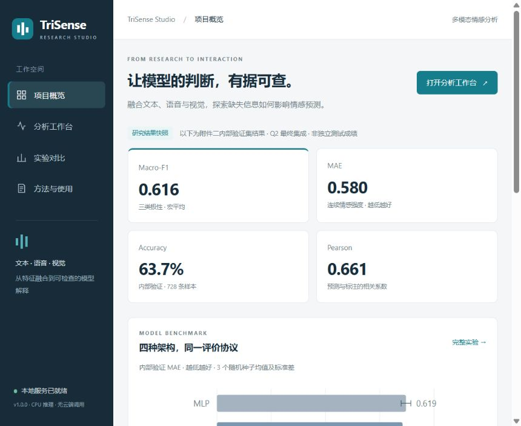
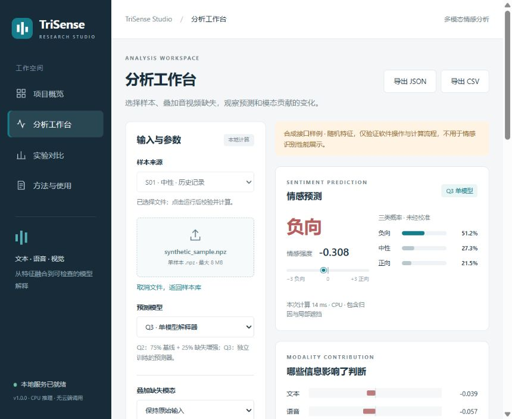
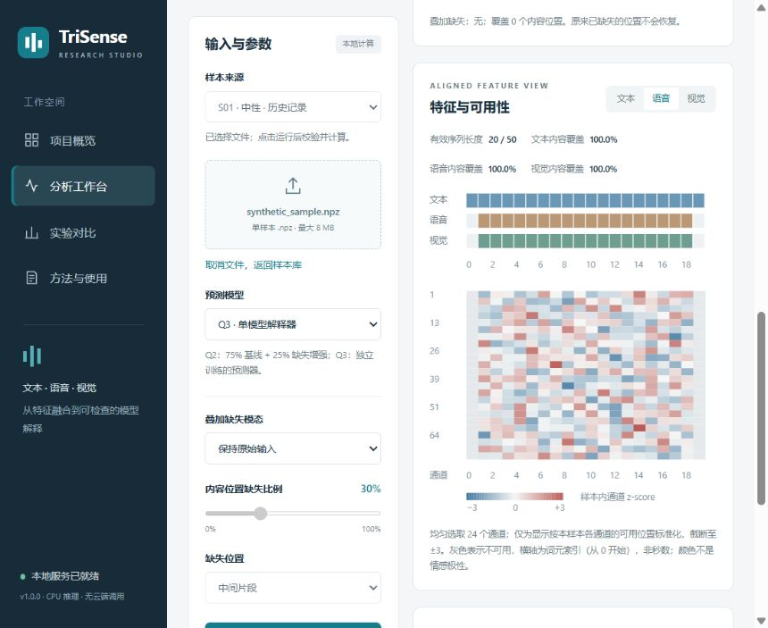
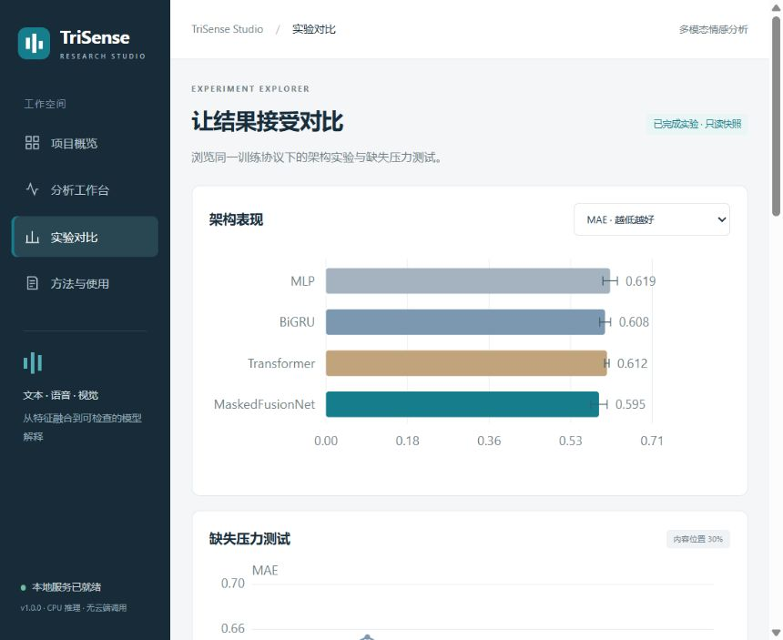

# TriSense Studio

**从数学建模实验到可交互的多模态情感分析软件。**

Python · PyTorch · FastAPI · 原生 JavaScript · CPU 本地推理

**在线体验：[GitHub Pages 网页版](https://xingyuliu586-tech.github.io/trisense-studio/)** · [网页版说明](docs/WEB_VERSION.md)

TriSense Studio 将已有多模态情感识别研究整理为一个可在浏览器使用的本地工作台：导入对齐特征，预测情感类别与强度，模拟音视频缺失，并查看模态贡献和局部证据。它是有真实模型推理的研究演示软件；四架构训练对比以已有实验快照呈现。









## 可以做什么

- **预测与导出**：Q3 单模型或 Q2 双模型集成，输出负向 / 中性 / 正向概率及 −3～3 强度，导出 JSON / CSV。
- **缺失实验**：在语音、视觉或二者同步的起始 / 中间 / 末尾位置添加缺失，比较干预前后的结果。
- **可解释分析**：精确枚举三模态的 8 种组合计算 Shapley；同时展示音视频局部滑窗遮挡与可用性热图。
- **实验浏览**：查看 MLP、BiGRU、Transformer、MaskedFusionNet 的三种子结果、误差条、缺失压力实验和训练过程。
- **历史样本**：浏览 20 条真实专项实验数值记录；原始文本和视频不随仓库分发。
- **离线使用**：依赖安装好后，无云端推理、API Key 或在线模型下载。上传文件仅在本机内存处理。
- **GitHub Pages 版**：网页下载模型参数后在浏览器内推理，也支持兼容 NPZ 导入；计算与原 Python 版逐项对照。详见 [网页版说明](docs/WEB_VERSION.md)。

## 三分钟试用

推荐 **Python 3.12、Windows 10/11、CPU**。首次安装需要联网下载依赖，PyTorch 下载体积较大。

Windows PowerShell，在项目目录执行：

```powershell
powershell -ExecutionPolicy Bypass -File .\setup.ps1
```

然后双击 **start.cmd**，或运行：

```powershell
.\.venv\Scripts\python.exe run.py
```

打开 `http://127.0.0.1:8765`。进入“分析工作台”，点击 **使用合成样例试运行**，再选择视觉缺失、点击运行，观察贡献变化。合成样例由随机数生成，只验证软件流程，不能据其输出判断识别效果。

已有 Python 环境或其他系统：

```bash
python -m venv .venv
# Windows: .venv\Scripts\activate
# macOS / Linux: source .venv/bin/activate
python -m pip install "torch>=2.6,<3" --index-url https://download.pytorch.org/whl/cpu
python -m pip install -r requirements.txt
python run.py
```

Windows 已实测；其他系统尚未验收。若 CPU wheel 源不支持你的系统，可按 PyTorch 官方安装方式装好 torch，再安装其余依赖。端口占用时运行 `python run.py --port 8766`，不自动打开浏览器可加 `--no-browser`。在启动窗口按 Ctrl+C 停止服务。

## 使用自己的数据

上传**单个兼容 NPZ**，字段为 `schema`、`text`、`audio`、`vision`、`text_bert`，详见 [输入规范](docs/INPUT_FORMAT.md)。模型要求与训练集一致的特征语义和尺度，不是数组维度相同就可以替代。

本版本不支持“任意视频上传即识别”。第一问自提取特征与题给特征的通道语义存在差异，不能仅修改 schema 后直接输入模型。BERT、Whisper、OpenFace 属于原研究的上游特征流程，不是本软件启动时额外调用的在线服务。

如你持有原研究附件四的可信 `01.pkl`～`20.pkl`，可在本机转换：

```bash
python scripts/import_local.py --trusted-pickle-dir "你的附件四目录" --i-trust-these-files
```

Pickle 可能执行代码，此命令只应用于来源可信的原始文件；网页不接受 PKL。转换结果写入被 Git 忽略的 `local_data/`。导入完成后刷新工作台，样本会显示“可运行”。没有私有特征时，20 条记录仍可浏览，但不能重新推理。

## 研究结果与边界

原研究训练集 3,395 条，内部验证集 728 条。Q2 最终集成结果：

| Macro-F1 | MAE | Accuracy | Pearson |
|---:|---:|---:|---:|
| 0.6158 | 0.5803 | 0.6374 | 0.6612 |

验证集参与早停、选模与集成权重选择，**不是独立测试集成绩**。四模型三种子对比是另一套统一协议，不能与最终集成混为同一实验。附件三、四无真实标签，历史样本仅展示预测和解释。上表来自原实验记录，本次软件迁移没有重新训练或重新评估完整数据集。

模型、归因定义及限制见 [模型说明](docs/MODEL_CARD.md)。文件来源与 SHA-256 见 [provenance.json](assets/provenance.json)。AI 开发过程见 [AI 协作记录](docs/AI_DEVELOPMENT.md)。

## 工程结构

```text
trisense/       输入校验、掩码融合模型、推理与解释、HTTP API
web/            四页工作台；不依赖 CDN，不需要 npm 构建
models/         原研究自行训练的三个下游模型检查点
assets/         数值结果快照、训练归一化统计与来源校验
examples/       有明确标记的合成特征样例
tests/          输入、接口、推理与解释一致性测试
scripts/        可信数据导入、迁移校验、发布包生成
docs/           输入规范、模型说明、验收与发布指南
local_data/     本机私有特征（不会提交 Git）
```

浏览器 → FastAPI → NPZ 校验 → 训练集归一化 → 掩码门控融合 → 分类 / 回归 → 精确 Shapley 与滑窗遮挡 → 结果展示 / 导出。

本地 API 说明：`http://127.0.0.1:8765/docs`；机器可读规范：`/openapi.json`。

## 测试与开发

```bash
python -m pip install -r requirements-dev.txt
python -m pytest tests -q
node tests/browser_parity.cjs
```

当前验收与迁移对齐结果见 [VALIDATION.md](docs/VALIDATION.md)。仓库包含 GitHub Actions 工作流，推送后在 Ubuntu / Python 3.12 运行测试；本地没有将其远程运行状态冒充为通过。

原论文工程在本机时，可以再次验证输入处理与前向计算：

```bash
python scripts/verify_research_parity.py --research-root "原研究工程目录"
```

这会比较软件与原 `q2_pipeline.py` 的归一化和网络前向，对三个检查点、四种缺失条件共 12 种情况校验。验证使用合成输入，不能替代真实数据集复现。

## GitHub 展示

建议仓库名：`trisense-studio`；简介：`A local multimodal sentiment analysis workbench with missing-modality simulation and exact Shapley explanations.`

准备提交时仅使用本目录，见 [发布指南](docs/GITHUB.md)。已有的竞赛论文、原始视频、聊天资料和 Python 环境不属于仓库内容。软件展示建议录制：历史记录 → 合成样例运行 → 遮挡视觉 → 贡献变化 → JSON 导出。视频中保留“合成接口样例”来源标识。

## 许可范围

自行编写的软件代码采用 [MIT License](LICENSE)。该许可证不向第三方授予原始比赛数据、视频、转写文本或上游预训练模型的权利。随附检查点与数值记录是本项目研究产物，其数据来源和使用边界另见 [DATA_POLICY.md](docs/DATA_POLICY.md)。
